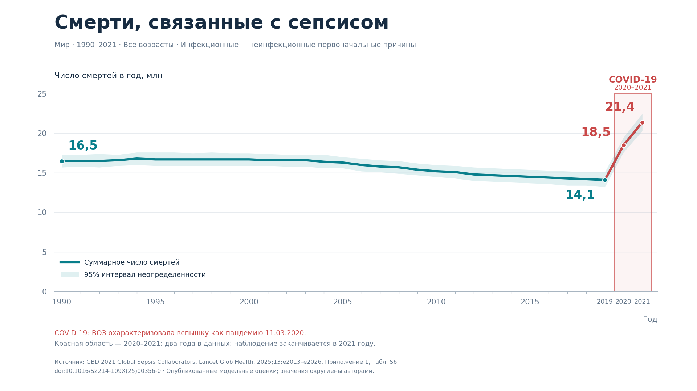

# Глобальные смерти, связанные с сепсисом, 1990–2021

Суммарная годовая кривая для всех возрастов: инфекционные и неинфекционные **первоначальные причины смерти** объединены. Это смерти, связанные с сепсисом, а не все смерти от инфекций и неинфекционных заболеваний в мире. Период исходного рисунка 3A — **1990–2021**, не 1912 год.



## Файлы

| Файл | Назначение |
| --- | --- |
| [SVG с текстом](output/sepsis_global_total_1990_2021.svg) | Прозрачный вектор; подписи остаются текстовыми объектами |
| [PNG 600 dpi](output/sepsis_global_total_1990_2021.png) | Прозрачный RGBA, 7680 × 4320 пикселей, 16:9 |
| [SVG с контурами](output/sepsis_global_total_1990_2021_outlined.svg) | Прозрачный вектор; буквы переведены в контуры для независимости от установленного шрифта |
| [Превью](output/sepsis_global_total_1990_2021_preview.png) | 1920 × 1080 на белом фоне, специально для README |
| [Таблица CSV](data/sepsis_deaths_1990_2021.csv) | Все 32 года, общий итог, обе категории и их 95% UI |
| [Код построения](plot_sepsis.py) | Python / Matplotlib, локальные данные, без сетевых запросов |
| [Настройки оформления](style.json) | Цвета, шрифт, толщина линии, размер и dpi |
| [Код извлечения](extract_table_s6.py) | Воспроизводимое извлечение всех строк из текстового фрагмента S6 |
| [Исходный фрагмент S6](sources/table_s6_source.txt) | Прямой результат `pdftotext -layout`, без ручного ввода чисел |
| [Происхождение данных](sources/provenance.json) | Ссылки, дата получения, SHA-256 приложения, страница таблицы |
| [Метаданные результата](output/summary.json) | Проверочные точки, настройки экспорта и даты COVID-19 |

## Источник и точность

GBD 2021 Global Sepsis Collaborators. **Global, regional, and national sepsis incidence and mortality, 1990–2021: a systematic analysis.** Lancet Glob Health. 2025;13:e2013–e2026. [DOI: 10.1016/S2214-109X(25)00356-0](https://doi.org/10.1016/S2214-109X(25)00356-0).

Числа взяты из **Supplementary appendix 1, Table S6**, столбец **All Causes → Death Counts (95% UI)**. [Приложение издателя](https://ars.els-cdn.com/content/image/1-s2.0-S2214109X25003560-mmc1.pdf?download=true). Таблица находится на физической странице 105 PDF (в напечатанном колонтитуле — 106). SHA-256 полученного приложения сохранён в provenance.json.

Это опубликованные модельные оценки, округлённые авторами до трёх значащих цифр; они перенесены без оцифровки изображения, без интерполяции отсутствующих лет и без сглаживания. Соединение соседних годовых точек прямыми линиями не означает наличие помесячных данных.

**Использован готовый общий итог из S6.** Категории в S6 округлены отдельно. Например, в 2021 году 15,5 + 5,81 = 21,31 млн, тогда как общий итог авторов составляет 21,4 млн. Это следствие опубликованного округления, а не основание заменять общий итог на 21,31. В CSV сохранены сумма округлённых категорий и её расхождение с общим итогом для проверки.

Лента показывает **95% интервал неопределённости общего числа смертей**, опубликованный в S6. Границы интервалов категорий не складываются. Никакие дополнительные предположения об их ковариации не делаются.

Перерисовка и объединение категорий являются адаптацией исходного рисунка. Статья опубликована по CC BY 4.0; авторы, название, DOI и сделанные изменения указаны здесь и на графике.

## Выделение COVID-19

Красный прямоугольник объединяет **две годовые оценки: 2020 и 2021**. Для годовых точек использованы границы ячеек 2019,5–2021,5; это графическое выделение лет, а не датировка начала пандемии с точностью до дня. Финальный участок той же суммарной кривой выделен красным. Линия и лента по-прежнему отражают все смерти, связанные с сепсисом, а не только смерти от COVID-19.

- Первые случаи обнаружены в декабре 2019 года.
- ВОЗ объявила чрезвычайную ситуацию международного значения 30.01.2020.
- ВОЗ охарактеризовала вспышку как пандемию **11.03.2020** — эта дата указана на графике.
- Режим глобальной чрезвычайной ситуации завершён **05.05.2023**, через примерно 3 года и 3 месяца после объявления. Это не означает исчезновения COVID-19 или объявления конца пандемии.
- **Данные статьи заканчиваются в 2021 году**, поэтому красная область не может показывать всю дальнейшую продолжительность пандемии. На графике это прямо поясняется.

Источник дат: [ВОЗ, Coronavirus disease (COVID-19) pandemic](https://www.who.int/europe/emergencies/situations/covid-19/).

## Воспроизведение и редактирование

Из корня репозитория после установки его requirements.txt:

```bash
python figures/sepsis_global/extract_table_s6.py
python figures/sepsis_global/plot_sepsis.py
```

На Windows можно использовать `py -3.12` вместо `python`. Первая команда заново создаёт CSV из сохранённого фрагмента S6; для изменения данных вручную пропустите её и выполните только построение. Вторая команда перезаписывает только файлы в этой папке output.

В `style.json` меняются основные цвета, шрифт, dpi, ширина/высота, заголовок и подзаголовок. Расположение подписей и выделения COVID-19 задаётся в `plot_sepsis.py`. SVG с текстом предназначен для редактирования в векторном редакторе; версия с контурами сохраняет внешний вид без необходимости иметь исходный шрифт. PNG не содержит редактируемых объектов.

## Опубликованные данные

Единицы — **млн смертей в год**; UI — 95% интервал неопределённости. Ниже обе категории оставлены только для проверки источника; на графике они объединены.

| Год | Инфекционные | Неинфекционные | Общий итог S6 | 95% UI общего итога |
| --- | ---: | ---: | ---: | --- |
| 1990 | 11,80 | 4,69 | 16,50 | 15,70–17,30 |
| 1991 | 11,80 | 4,72 | 16,50 | 15,80–17,30 |
| 1992 | 11,80 | 4,75 | 16,50 | 15,70–17,40 |
| 1993 | 11,80 | 4,81 | 16,60 | 15,90–17,30 |
| 1994 | 11,80 | 4,97 | 16,80 | 16,00–17,60 |
| 1995 | 11,80 | 4,91 | 16,70 | 15,90–17,60 |
| 1996 | 11,80 | 4,91 | 16,70 | 15,90–17,60 |
| 1997 | 11,80 | 4,90 | 16,70 | 15,90–17,50 |
| 1998 | 11,80 | 4,93 | 16,70 | 15,90–17,60 |
| 1999 | 11,70 | 4,97 | 16,70 | 15,90–17,50 |
| 2000 | 11,70 | 5,00 | 16,70 | 15,90–17,50 |
| 2001 | 11,60 | 5,02 | 16,60 | 15,90–17,40 |
| 2002 | 11,50 | 5,06 | 16,60 | 15,80–17,30 |
| 2003 | 11,50 | 5,10 | 16,60 | 15,80–17,30 |
| 2004 | 11,30 | 5,13 | 16,40 | 15,60–17,30 |
| 2005 | 11,20 | 5,14 | 16,30 | 15,60–17,00 |
| 2006 | 10,90 | 5,11 | 16,00 | 15,20–16,80 |
| 2007 | 10,70 | 5,14 | 15,80 | 15,10–16,60 |
| 2008 | 10,40 | 5,21 | 15,70 | 14,90–16,50 |
| 2009 | 10,20 | 5,23 | 15,40 | 14,70–16,20 |
| 2010 | 9,96 | 5,28 | 15,20 | 14,50–16,00 |
| 2011 | 9,72 | 5,35 | 15,10 | 14,30–15,90 |
| 2012 | 9,47 | 5,36 | 14,80 | 14,00–15,70 |
| 2013 | 9,29 | 5,41 | 14,70 | 13,90–15,60 |
| 2014 | 9,12 | 5,49 | 14,60 | 13,80–15,50 |
| 2015 | 8,95 | 5,54 | 14,50 | 13,70–15,40 |
| 2016 | 8,78 | 5,62 | 14,40 | 13,60–15,30 |
| 2017 | 8,63 | 5,67 | 14,30 | 13,40–15,20 |
| 2018 | 8,48 | 5,72 | 14,20 | 13,40–15,10 |
| 2019 | 8,34 | 5,77 | 14,10 | 13,20–15,10 |
| 2020 | 12,70 | 5,78 | 18,50 | 17,60–19,50 |
| 2021 | 15,50 | 5,81 | 21,40 | 20,30–22,50 |
