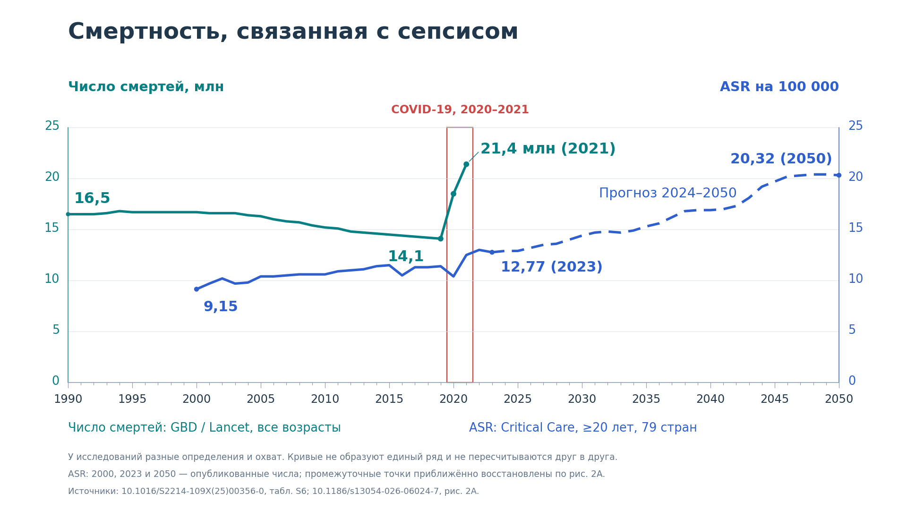

# Сепсис: число смертей и возраст-стандартизованная смертность, 1990–2050

Две независимые серии на одной **равномерной числовой оси времени**. Каждому году соответствует одинаковая ширина. Слева — число смертей в миллионах, справа — ASR на 100 000. Совпадающие деления 0–25 на двух осях являются настройкой отображения разных единиц, а не формулой пересчёта.



## Готовые файлы

| Файл | Что внутри |
| --- | --- |
| [Чистый PNG](output/sepsis_combined_clean.png) | Прозрачный, 8000 × 4500, 600 dpi. Только оси, деления, цифры, кривые и рамка COVID |
| [Чистый SVG](output/sepsis_combined_clean.svg) | Те же элементы в векторе. Подписи делений — редактируемый текст |
| [Редактируемый PowerPoint](output/sepsis_combined_editable.pptx) | Слайд 1 — отдельные линии, числа, оси и кривые. Слайд 2 — они же с отдельными подписями |
| [PNG с подписями](output/sepsis_combined_annotated.png) | Прозрачный, 8000 × 4500. Образец готового оформления |
| [SVG с подписями](output/sepsis_combined_annotated.svg) | Векторная версия образца |
| [Только дополнительные подписи](output/sepsis_annotations_only.svg) | Прозрачный слой без осей и кривых, совмещается с чистым графиком без изменения размеров |
| [Данные Lancet](data/sepsis_deaths_1990_2021.csv) | 32 опубликованные годовые оценки и их 95% UI |
| [Данные Critical Care](data/critical_care_asr_2000_2050.csv) | 51 год, с отметкой точных опорных и приближённо оцифрованных значений |

Белый фон есть только у превью README. Основные PNG/SVG прозрачные. PNG сохраняет изображение целиком. Чтобы удалить отдельное число, линию или подпись, используйте PPTX либо SVG.

## Значение линий и границы данных

| Серия | Период | Показатель | Источник и охват |
| --- | --- | --- | --- |
| Бирюзовая | 1990–2021 | Смерти, связанные с сепсисом, млн в год | GBD / Lancet Global Health, мир, все возрасты, включая инфекционные и неинфекционные первоначальные причины |
| Синяя сплошная | 2000–2023 | Возраст-стандартизованная смертность (ASR) на 100 000 | Critical Care, взрослые ≥20 лет, 79 стран, явное кодирование сепсиса как основной/первоначальной причины |
| Синяя пунктирная | 2024–2050 | Прогноз той же ASR | Модель Critical Care. Отрезок соединения начинается в последней исторической точке 2023 года |

**После 2021 года бирюзовая линия отсутствует. До 2000 года синяя линия отсутствует.** Пропуски не превращаются в нули и не заполняются прогнозом другого исследования. Серые траектории отдельных стран и все интервальные заливки исключены из изображения. Отсутствие заливки не означает отсутствие неопределённости у источников.

Ряды нельзя соединять в одну непрерывную кривую или пересчитывать из ASR в глобальное число смертей: они различаются возрастным охватом, географией, определением смерти и стандартизацией. Их наложение показывает две опубликованные траектории на общей оси времени. Пересечения линий и одинаковая высота в разных единицах не имеют самостоятельного эпидемиологического смысла.

## Числа и точность

**Lancet:** все 32 строки взяты из приложения 1, таблица S6, All Causes → Death Counts (95% UI). Опубликованные модельные оценки округлены авторами до трёх значащих цифр. На графике использован готовый общий итог: 1990 — 16,5 млн, 2019 — 14,1 млн, 2020 — 18,5 млн, 2021 — 21,4 млн. Отдельно округлённые инфекционные и неинфекционные категории могут немного отличаться от общего итога при сложении. Сохранены исходный [текст S6](sources/table_s6_source.txt) и [происхождение данных](sources/provenance.json).

**Critical Care:** в тексте опубликованы точные опорные значения **2000 — 9,15; 2023 — 12,77; 2050 — 20,32** на 100 000. Основной текст и приложение из 12 таблиц не содержат полной ежегодной таблицы центральной кривой Figure 2A. Поэтому остальные **48 годовых точек приближённо оцифрованы** с оригинального рисунка издателя и округлены до 0,1. Это восстановление опубликованной линии, а не исходный массив авторов. Столбец `value_source` различает `published_text` и `digitized_figure2A_approximate`. Пиксельные координаты, исходная оценка до округления, калибровка осей и SHA-256 рисунка сохранены в CSV и [метаданных](sources/critical_care_provenance.json). Погрешность оцифровки не оценивалась как статистический ДИ.

Никакая новая модель прогноза здесь не рассчитывается. Пунктир повторяет центральную траекторию авторов. Доверительные интервалы исходной модели не показаны по запросу.

## COVID-19 и равномерность времени

Красная рамка объединяет две годовые оценки **2020 и 2021**. Её границы 2019,5–2021,5 — границы годовых ячеек. Они не датируют начало пандемии с точностью до дня. ВОЗ охарактеризовала вспышку как пандемию **11.03.2020**. Окончание данных Lancet в 2021 году не является датой окончания пандемии.

Шаг основных делений всегда 5 лет: 1990, 1995, …, 2050. Между ними есть одинаковые годовые риски. На холсте 1280 px одному году соответствует **1088 / 60 = 18,1333 px**. COVID не получает другой масштаб: акцент дают красная рамка и крупные точки на бирюзовой кривой.

## Как менять график в PowerPoint

1. Откройте `sepsis_combined_editable.pptx`.
2. На **слайде 1** уже есть чистый график. Выделяйте нужные оси, линии и цифры. Они являются отдельными объектами, поэтому их можно перемещать, перекрашивать или удалять. Кривые — редактируемые свободные линии. Через «Изменить точки» можно править их геометрию.
3. На **слайде 2** дополнительные подписи являются отдельными текстовыми полями. Удаление заголовка или подписи не затрагивает кривые. Это образец того, куда поставить текст.
4. Используйте **Область выделения** для точного выбора объектов. Имена осей: `left_axis`, `right_axis`, `time_axis`. Кривые: `GBD_total_deaths_1990_2021`, `ASR_historical_2000_2023`, `ASR_forecast_2024_2050`. Рамка: `covid_2020_2021`.
5. Если нужно менять сами числовые данные, измените CSV и заново выполните `plot_sepsis.py`, затем генератор PPTX. Правка точек вручную в PowerPoint меняет только геометрию, а не исходную таблицу.
6. Для переноса на свой слайд выделите нужные объекты, скопируйте и вставьте с сохранением исходного оформления. После проверки можно сгруппировать весь график.

PPTX содержит нативные линии, свободные кривые, фигуры и текстовые поля. Все элементы можно редактировать независимо. Встроенной Excel-диаграммы в нём нет, числовой источник хранится в CSV. Его проверили по структуре OOXML и визуальному рендеру; интерактивное открытие в Microsoft PowerPoint в этой среде не выполнялось.

## Какие подписи добавить к чистому PNG

| Расположение | Текст | Цвет |
| --- | --- | --- |
| Над левой осью | Число смертей, млн | Бирюзовый |
| Над правой осью | ASR на 100 000 | Синий |
| Над красной рамкой | COVID-19, 2020–2021 | Красный |
| У верхней точки бирюзовой кривой | 21,4 млн (2021) | Бирюзовый |
| У синей точки 2023 года | 12,77 (2023) | Синий |
| Над пунктиром справа | Прогноз 2024–2050 | Синий |
| У последней синей точки | 20,32 (2050) | Синий |
| Под графиком слева | Число смертей: GBD / Lancet, все возрасты | Бирюзовый |
| Под графиком справа | ASR: Critical Care, ≥20 лет, 79 стран | Синий |
| Внизу небольшим текстом | Различаются определения и охват; промежуточные точки ASR оцифрованы с рисунка | Серый |

Точные координаты и имена всех подписей приведены в [editable_scene.json](output/editable_scene.json). Отдельный SVG со слоем подписей имеет тот же холст и совмещается с чистым графиком без подгонки.

## Код

- [plot_sepsis.py](plot_sepsis.py) — чистый график, образец подписей, SVG/PNG и общая векторная сцена.
- [style.json](style.json) — палитра, толщина линий, положение области построения.
- [digitize_critical_care.py](digitize_critical_care.py) — воспроизводимая оцифровка рисунка 2A. Нужны NumPy и Pillow. При отсутствии `--figure` скачивает рисунок по ссылке издателя.
- [extract_table_s6.py](extract_table_s6.py) — повторное извлечение чисел Lancet из сохранённого текстового фрагмента.
- [build_powerpoint.mjs](build_powerpoint.mjs) — PowerPoint через `@oai/artifact-tool` в Codex primary runtime.

Обычное построение работает с локальными CSV и зависимостями корневого `requirements.txt`:

```bash
python figures/sepsis_global/plot_sepsis.py
```

Для повторной оцифровки установите Pillow дополнительно. Изменение CSV с ASR не требует запуска оцифровки: достаточно повторить построение. Скрипт PowerPoint запускается после создания `editable_scene.json` в среде с Artifact Tool; обычный Python-скрипт его не требует.

## Источники

1. GBD 2021 Global Sepsis Collaborators. Global, regional, and national sepsis incidence and mortality, 1990–2021: a systematic analysis. Lancet Glob Health. 2025;13:e2013–e2026. [DOI](https://doi.org/10.1016/S2214-109X(25)00356-0). Supplementary appendix 1, Table S6.
2. Woo HG, Kim S, Oh J, et al. The economic value of preventing projected sepsis-related deaths among adults in 79 countries, 2000–2023, with projections to 2050: a modelling study. Critical Care. 2026;30:288. [Статья](https://link.springer.com/article/10.1186/s13054-026-06024-7). Figure 2A.
3. [ВОЗ: COVID-19 pandemic](https://www.who.int/europe/emergencies/situations/covid-19/).

График построен заново по фактическим числовым оценкам и оцифрованным центральным значениям. Изображения, серые траектории и оформление рисунка Critical Care не копируются в результат. Ссылки на оригиналы и описание обработки сохранены. Старый набор рисунков 1990–2021 заменён этим совмещённым набором. Данные S6 сохранены.
